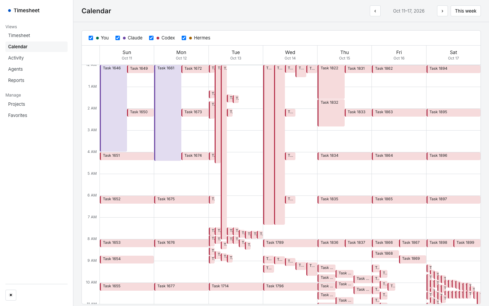
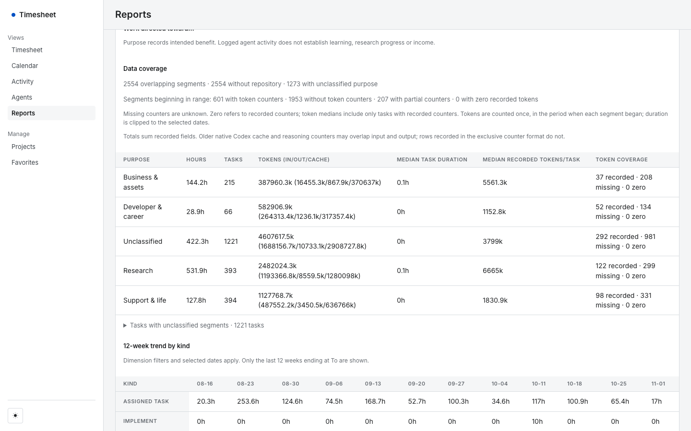

# Timetracker

**Status: Retired 2026-11-02.** The production service was shut down by its owner. This repository is kept as a record of what it did and why it was stopped. Read the [case study](docs/case-study/README.md) for the full account.

> **About this repository.** This is a sanitized snapshot of a private repository, published as a single commit because the original history contains private content. It has been stripped of personal data and deployment configuration (`wrangler.jsonc` is a placeholder template). The private history spans 2026-08-04 to 2026-10-30 with 313 commits and 158 merged PRs, written largely with AI coding agents (Codex and Claude) under my direction, as the commit trailers there record. Figures in this document that count commits, PRs, issues or production data (313 commits, 158 merged PRs, 71 issues, 2,554 entries and so on), and the commit hashes and `PR #` / issue numbers it cites, refer to that private repository and cannot be checked here. The hosted service is retired. Reviewers can ask to see the private history.

A time-tracking service for AI coding agents. Each agent (Codex, Claude Code, Hermes) logged the tasks it worked on through a CLI. The service stored those entries, attributed token usage to them, and showed them on a dashboard. It ran from 2026-08-05 to 2026-11-02 and logged 2,554 entries over 89 active days.

How it was built: the owner directed and reviewed the work, and coding agents wrote much of the code. 231 of the 313 commits on the private repository's `master` carry an AI co-author trailer (Codex or Claude). This is not a solo hand-written project.


*Calendar view, anonymized real data: each block is one logged agent task; overlapping blocks are agents working at once.*


*Reports view, anonymized real data. Project names, task descriptions and repositories were replaced before capture; timestamps, durations, token counts and entry counts are unchanged.*

## Architecture

```
agent CLI (Python)  --X-AUTH token + Access service token-->  Cloudflare Worker  <--Access JWT--  browser dashboard
backend/timetracker_log.py                                    worker/index.js                    frontend/ (vanilla JS)
                                                                   |
                                                              Cloudflare D1 (migrations/)
                                                              cron every 15 min: close stale timers
```

- `worker/` Cloudflare Worker (single file API, no framework). Serves the dashboard as static assets and the JSON API.
- `migrations/` D1 schema, seven additive migrations.
- `frontend/` dashboard, no build step. Day/week/month timesheet, calendar, activity heatmaps, agents, reports, CSV export.
- `backend/` the logging CLI agents called (`start`, `pause`, `resume`, `end`, `status`) and token collectors for each agent.
- `scripts/` D1 backup job, browser end-to-end checks, and the local demo server.
- Auth: the dashboard hostname required a Cloudflare Access JWT, which the Worker verifies (signature, issuer, audience, expiry). The agent hostname required an Access service token plus a per-agent token.

## Run it locally with demo data

Needs Node 22+ (run here on Node 26) and `npm ci`. Nothing here contacts Cloudflare.

```sh
npm ci
node scripts/demo/serve.mjs          # http://127.0.0.1:8788
```

This applies the migrations to a throwaway local D1 under `.wrangler/demo-state`, loads [`scripts/demo/seed.sql`](scripts/demo/seed.sql) (synthetic: 99 invented entries, three invented agents), and starts `wrangler dev --local`. A small proxy stands in for Cloudflare Access: it signs a short-lived JWT with a key generated on each run and hands the Worker the matching public key. The Worker's auth code is the production code, unchanged. The seed's dates are 2026-10-19 to 2026-11-01, so use the calendar's previous-week arrows or the Reports date range to see them.

To load a different seed: `node scripts/demo/serve.mjs --seed path/to/seed.sql`.

## Tests

```sh
python3 -m pip install pytest pytest-asyncio
npm run test:worker                  # Worker API, local D1 via wrangler
(cd frontend && node --test)         # dashboard logic
python3 -m pytest backend/tests -q   # CLI and token collectors
```

`npm run test:browser` runs Playwright scenarios and needs a Chromium headless shell.

## Docs

- [Case study](docs/case-study/README.md): problem, build, data, shutdown
- [Model and agent API](docs/MODEL_API.md), [operations](docs/OPERATIONS.md), [purpose model](docs/PURPOSES.md), [weekly review template](docs/WEEKLY_REVIEW.md)
