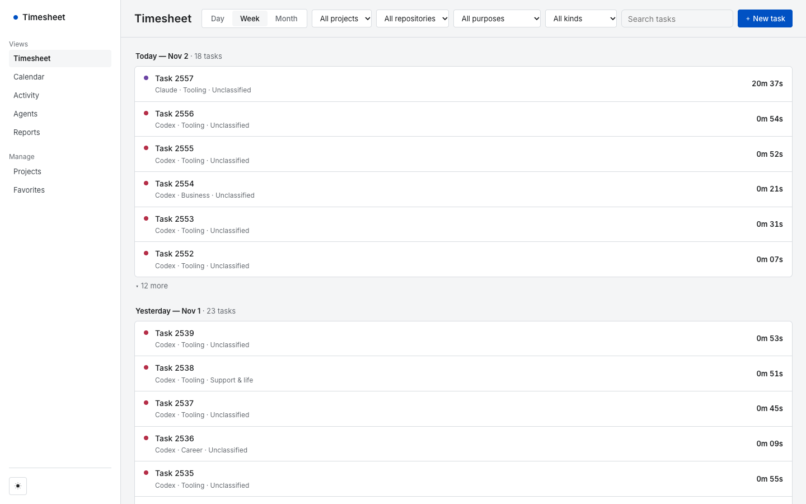
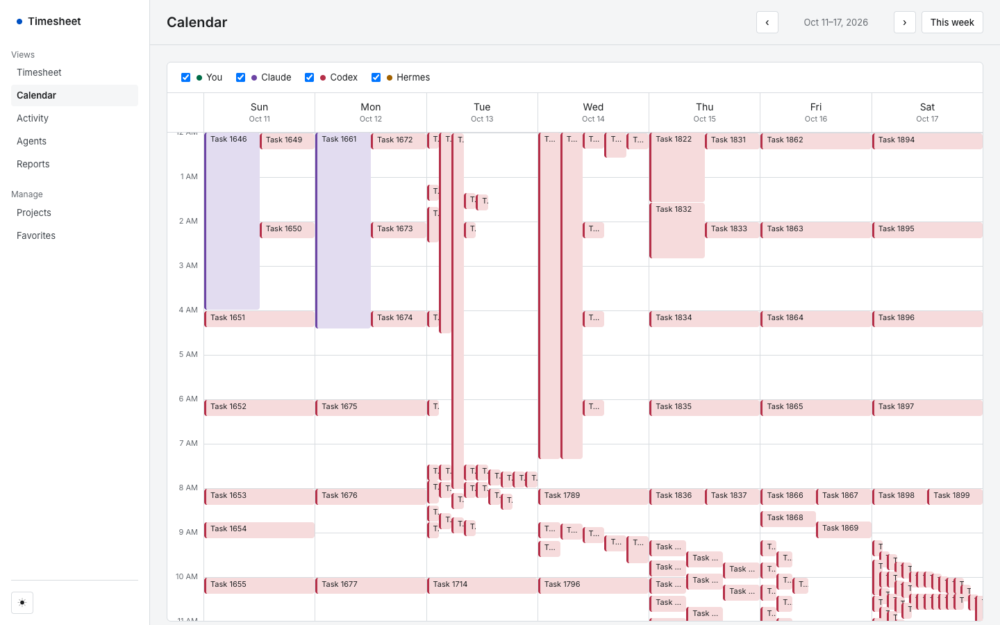
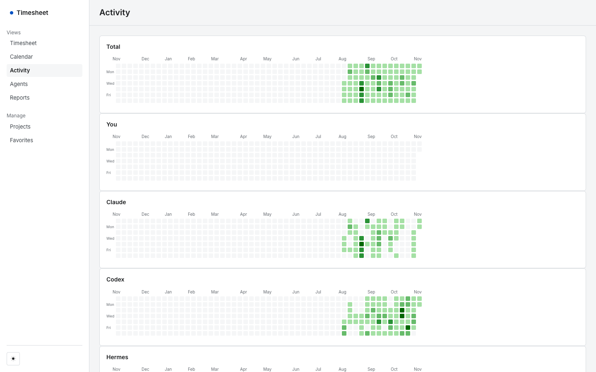
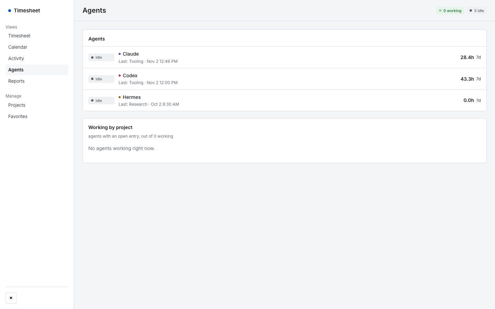
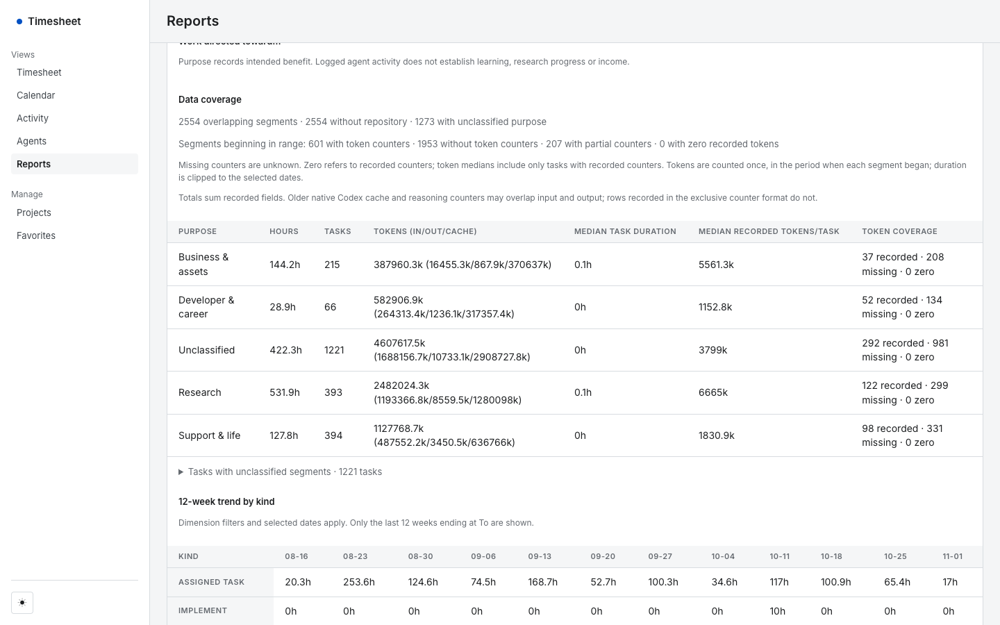
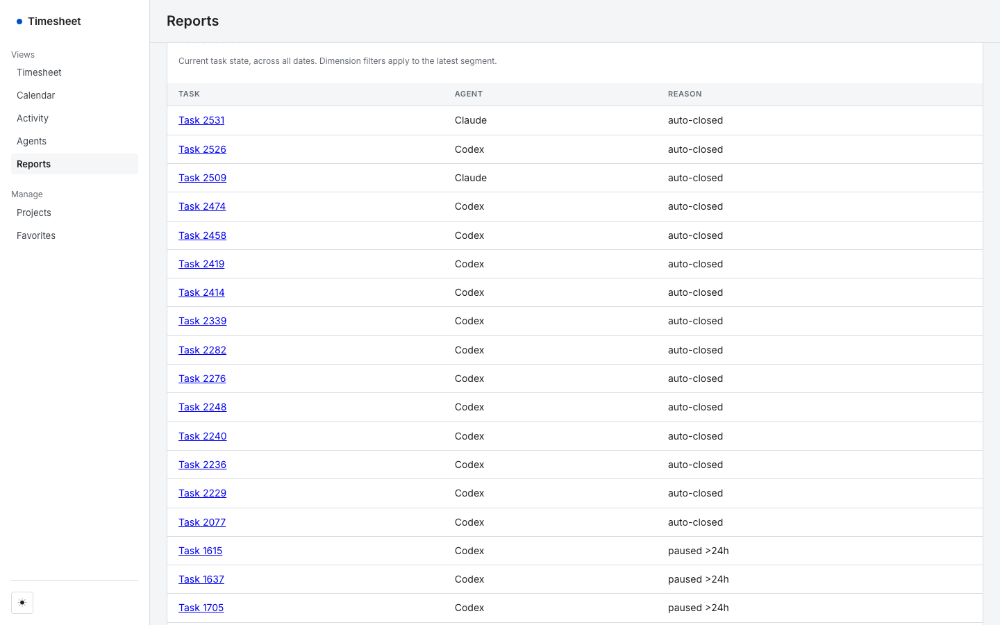

# Timetracker case study: an agent time tracker, and why I shut it down

Status: retired 2026-11-02. Run: 2026-08-05 to 2026-11-02.

> **About this repository.** This is a sanitized snapshot of a private repository, published as a single commit because the original history contains private content. It has been stripped of personal data and deployment configuration (`wrangler.jsonc` is a placeholder template). The private history spans 2026-08-04 to 2026-10-30 with 313 commits and 158 merged PRs, written largely with AI coding agents (Codex and Claude) under my direction, as the commit trailers there record. Figures in this case study that count commits, PRs, issues or production data (313 commits, 158 merged PRs, 71 issues, 2,554 entries and so on), and the commit hashes and `PR #` / issue numbers it cites, refer to that private repository and cannot be checked here. The hosted service is retired. Reviewers can ask to see the private history.

## How this was built

I directed and reviewed this project. Coding agents wrote much of the code. Of the 313 commits on `master` before this write-up, 231 carry a `Co-Authored-By` trailer for an AI agent (Codex 122 alone, Claude 95, both 14), counted with `git log`. The rest have no trailer. Treat this as a project about running agent-written software and measuring it, not as hand-written engineering.

## Problem

I ran several coding agents at once across research, career, business and tooling work. I wanted to know where the agent effort went and whether it matched what I meant to be working toward. The plan was a log that agents filled in themselves, plus a dashboard to review it weekly.

## What was built

- A Cloudflare Worker with a D1 database, behind Cloudflare Access, with a JSON API (`worker/index.js`, `migrations/0001`-`0007`).
- A Python CLI (`backend/timetracker_log.py`) that agents called to `start`, `pause`, `resume` and `end` a task. On `end` it collected token usage from each agent's local records.
- A vanilla-JS dashboard with no build step (`frontend/`): timesheet, calendar, activity heatmaps, agents, reports with CSV export.
- A 15-minute cron that closes timers left open (`feat/stale-sweep-cron`, PR #63), a daily D1 backup job (`scripts/backup-d1.sh`), and a purpose model for tagging each task with the benefit it was meant to serve (`docs/PURPOSES.md`).
- Size: 313 commits, 158 merged PRs, 71 issues. Tests at the end: 111 Worker, 124 frontend, 475 Python.

## Screenshots

All screenshots show real data, anonymized. Before capture I replaced every task description with a generic label ("Task 1042"), mapped project names to neutral ones (Research, Career, Business, Tooling, Project A to E), and cleared the repository field and user emails. Timestamps, durations, token counts, agent names and entry counts are unchanged. The anonymization has one visible side effect: because repositories were cleared, the Reports page says "2554 without repository". Images were not edited after capture. They are produced by `scripts/capture-case-study.py` against the demo server.

Timesheet, week view. One row per task, with agent, project and purpose. Most rows read "Unclassified": the purpose field was optional.

Calendar, week of Oct 11 to 17. Each block is one logged segment. Overlap is agents running in parallel. The tall blocks are segments that ran for hours.

Activity heatmaps over the whole run, one for all agents and one per agent.

Agents page: last task and trailing seven-day total per agent. The trailing totals are summed segment durations, not human time.

Reports, 2026-08-05 to 2026-11-02, grouped by purpose. The Data coverage block states how much of the data is missing: counters missing for most segments, 1,273 segments with no purpose. The page counts 601 segments with token counters. That figure is 587 entries with a per-entry token record, plus 14 older entries whose counters sit on the entry row itself.

Reports, "Needs attention": tasks the system flagged as auto-closed or paused for more than 24 hours.

## Engineering decisions

Each item below is from code and tests in this repo, not from memory.

**Token attribution across agents.** One logged task can contain work from more than one agent, so `end_task` accepts `tokens_by_agent` (`{username: counters}`) next to a flat manual override, and the Worker stores counters per entry and per user in `timesheet_tokens` (`backend/timetracker_log.py`, `migrations/0001`). Collectors read each agent's own records: Claude Code transcripts bounded to the entry's time window (PR #229), Codex and Hermes usage windowed by entry time (PR #81). Auto-detection dispatches on the logged agent identity, not on environment variables, because a Claude session ending a Codex-profile entry would otherwise record Claude's tokens against Codex (comment in `_auto_detect_tokens`). PR #162 removed an invented allocation of tokens to the human and showed recorded counters only. PR #177 and `migrations/0007` record the counter format (`codex_response_exclusive_v1`) because older Codex cache and reasoning counters could overlap input and output, so sums across formats were unreliable. `docs/NATIVE_USAGE.md` describes the opt-in collector for the newer format.

**Race-safe task writes.** Task identity and the one-running-entry-per-task rule are enforced in single SQL statements rather than read-then-write in the Worker. New entries and their `task_id` are assigned in one D1 batch (commit `08ff1d6`). Resume inserts only if no open entry exists, via `INSERT ... WHERE NOT EXISTS` (`worker/index.js`, `createTimesheet`). `worker/atomic-resume.test.mjs` and `worker/purpose-race.test.mjs` inject a competing write between the check and the write and assert the outcome.

**Race-safe dashboard reloads.** A slow background refresh could overwrite a newer view. `load()` takes a sequence number and only the newest started reload may publish data or errors (`frontend/app.js`, `loadSeq`; commit `658001c`, issue #219). `frontend/load-race.test.js` runs the real `load()` source with controllable fetch promises.

**Stale timers swept by cron, not on read.** Open timers older than a threshold (`TIMETRACKER_STALE_HOURS`, 8) are closed by a scheduled job every 15 minutes, with `end_reason = 'auto'` (PR #63). In the data this closed 88 entries, which the Reports page flags under "Needs attention" along with tasks paused for more than 24 hours.

**Access JWT verification in the Worker.** Dashboard requests must carry a Cloudflare Access JWT, checked for RS256 signature against the Access JWKS, issuer, audience and expiry; an optional `OWNER_EMAIL` restricts which identity may use it (`worker/index.js`, `verifyAccessJwt`). The local demo reuses this code path by supplying its own signing key through the `ACCESS_JWKS` variable (`scripts/demo/serve.mjs`).

**Backups and a restore drill.** `scripts/backup-d1.sh` exports D1 to an external disk, rejects empty or invalid exports, and falls back to a local directory. `docs/OPERATIONS.md` documents restoring a real export into an isolated local D1. I recorded one restore drill on 2026-10-13 (1,747 segments restored, `integrity_check: ok`, zero foreign-key violations, next scheduled run not yet observed); that record is in the private repository and is not included here.

## What the data showed

All figures are from the restored production export (2,554 entries) unless noted.

- Volume: 2,554 entries over 89 active days from three agents: Codex 1,982, Claude Code 366, Hermes 206.
- Coverage was poor. 587 entries (23%) have a per-entry token record. 1,273 (50%) have no purpose. 1,348 (53%) are in the catch-all `etc` project (shown as Tooling in the screenshots).
- The activity "kind" field carried almost no information. 2,499 of 2,554 entries (98%, computed from the database) are the default kind "Assigned Task". The kind trend table in Reports is almost entirely that one row.
- 88 entries were stale timers closed automatically.
- Hours in Reports are summed segment durations. With agents running in parallel and timers left open, they do not measure how long anything took.

The repo's own review template said as much. `docs/WEEKLY_REVIEW.md`: concurrent agents, idle intervals, auto-closed timers and overlapping native token counters "prevent those totals from measuring human effort, mastery, or economic return."

## Why I shut it down

My reason, in one sentence: "i feel like not a lot of analysis is actually getting used."

That is my judgment. The dashboard collected no view data, so I cannot say how often it was opened. What the repo does show is that the numbers it produced had known limits, which I wrote down myself (above).

The shutdown also turned up a failure. The scheduled D1 backup job was failing on and off with `Authentication error [code: 10000]`: 14 failed runs in its log, the latest on Nov 1. Copies from other runs landed in the local fallback directory, so the newest copy on the external drive was dated Oct 14 and the newest anywhere was Oct 28. I found this only during the shutdown, not from an alert. The private repository records an earlier episode of the same error (Oct 12 and 13), with a manual run verified on Oct 13 and the scheduled run explicitly marked as not yet observed; that record is not in this snapshot. Before turning anything off I took and verified fresh backups.

Shutdown, 2026-11-02: backups verified, then the Worker routes and the cron trigger were removed.

## What replaced it

A script that derives reports from logs the agents already write. Agents log nothing by hand.

## What I would do differently

These follow from the figures above; they are my reading, not measured results.

- Decide what question the reports answer before building the logger. Half the entries have no purpose and 98% have the default kind, so the fields that would have answered "where did the effort go" were the ones left empty.
- Do not ask agents to hand-log what their existing logs already contain. Token coverage of 23% came from collectors reconstructing usage after the fact.
- Treat backups as a monitored system, not a script. This job failed on and off and quietly wrote somewhere other than the intended disk, and nobody noticed for weeks. Alert on the age of the newest copy at the intended destination, not only on job failure.

## Reproducing

`README.md` has the demo-server instructions. Tests were run on this branch: Worker 111 of 111 passed, frontend 124 of 124, Python 475 of 475. The browser end-to-end suite (`npm run test:browser`) was not run for this write-up.
